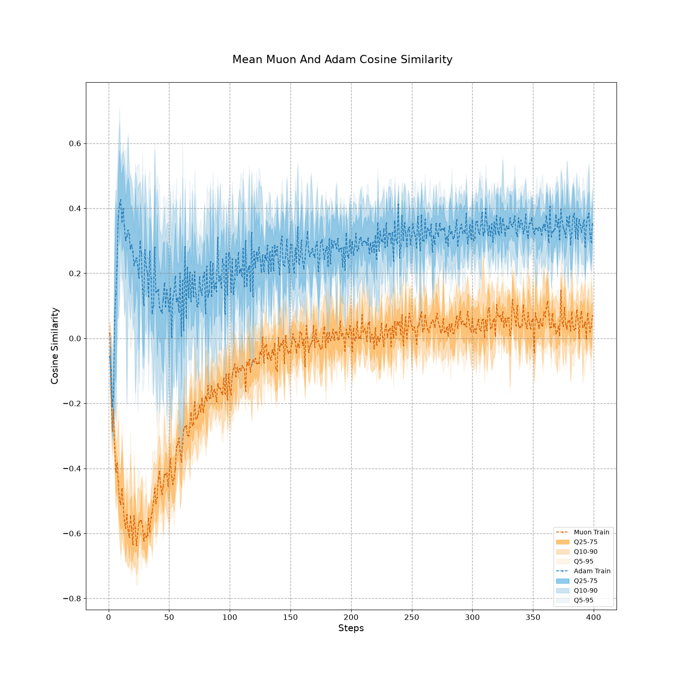
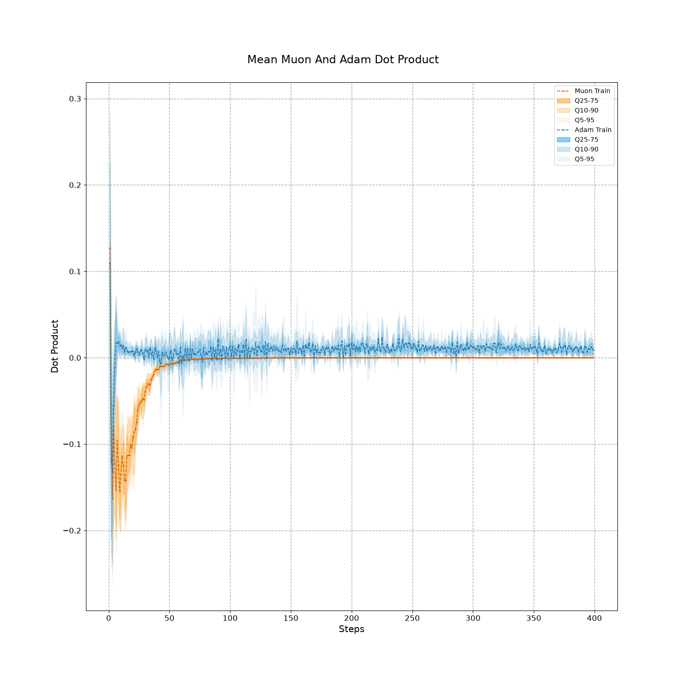
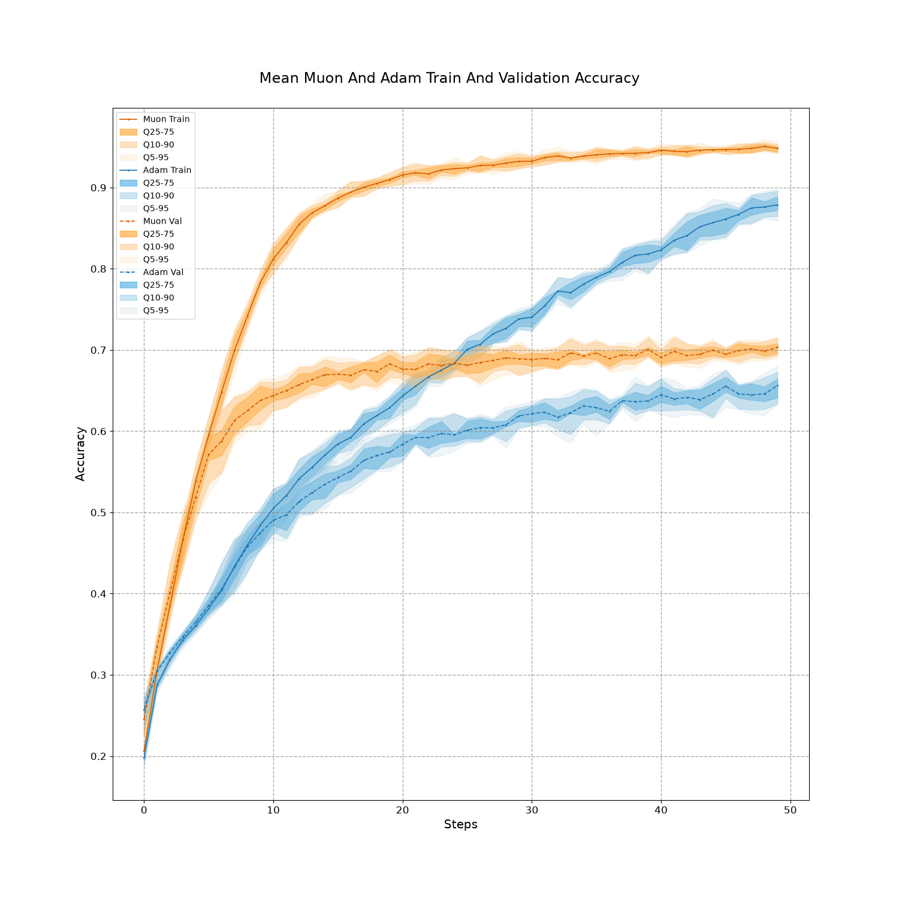
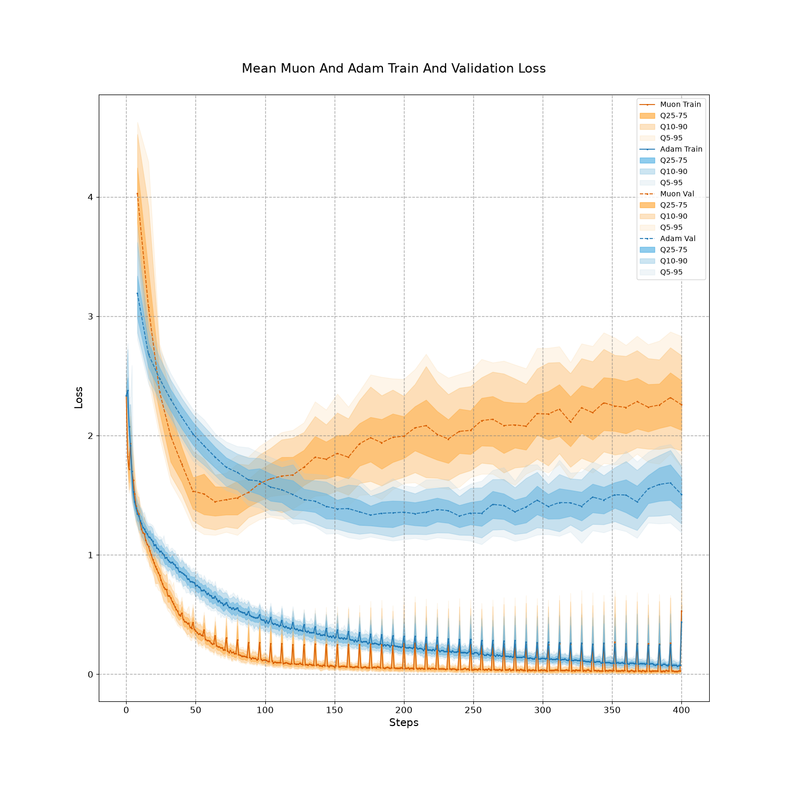
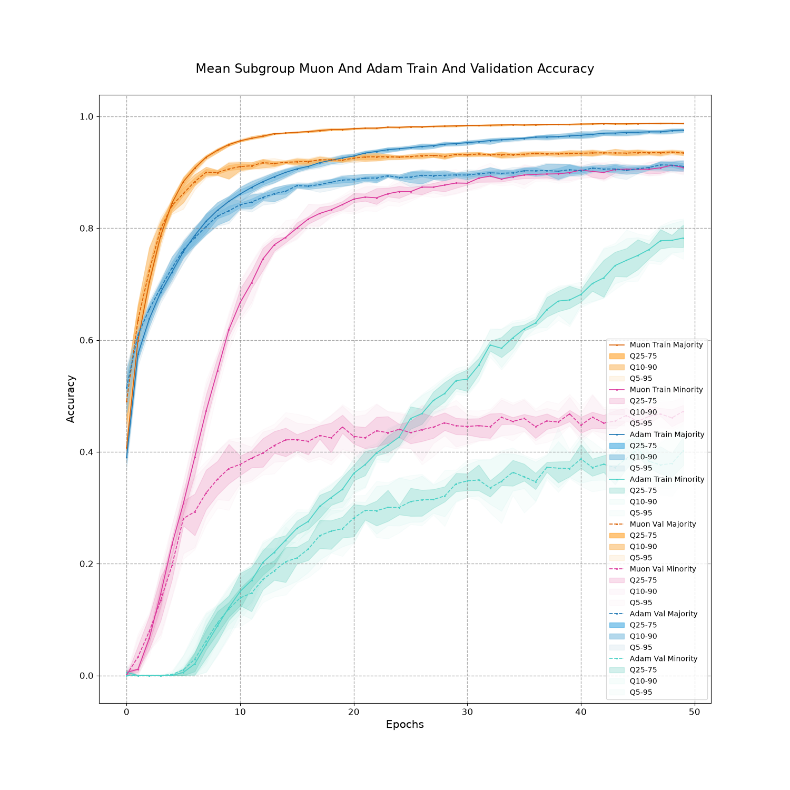

# Visualising Gradient Correlations of Adam and Muon In Neural Network Layers

## Description

Tracks first order gradient correlations across layers of any neural network optimisation occurs under [Muon](https://github.com/KellerJordan/Muon) and Adam. The measure was first introduced in [Exploring Gradient Oscillation in Deep Neural Network Training](https://ieeexplore-ieee-org.uplib.idm.oclc.org/document/10313361). This uncovers stable or oscillatory gradient phases which are then mappable to various loss and accuracy performance benchmarks adapted from [How Muon’s Spectral Design Benefits Generalization: A Study on Imbalanced Data](https://proceedings.iclr.cc/paper_files/paper/2026/file/e6231c5f46598cfd09ff1970524e0436-Paper-Conference.pdf). The scientific paper designs and/or uses common benchmarks to study the inductive learning biases ("rich" or "simple") of Muon and Adam. 

This is the first instance open sourcing experiments inspired by the above studies. Our implementation would not have been possible without their incredible published research. 

### What is the gradient correlation? 

The gradient correlation (GCORR) simply measures the (linear algebra) dot product *then* cosine similarity per layer of (adjacent) gradient vector pairs generated as optimisation occurs. For $n$ train steps this obtains $n-1$ **scalars** per layer. Taking the history for all layers together, a grid is formed. 

During live computation for storage only the past gradient vectors are required in memory. For time taken the GCORR hook takes only 0.1 - 0.2% of train budget (included validation as design choice). 

## Experiments Possible

These are the finished pipelines. 

### Class Imbalance Small and Large on Residual Networks

This is a hybrid mix that extends both studies of [Exploring Gradient Oscillation in Deep Neural Network Training](https://ieeexplore-ieee-org.uplib.idm.oclc.org/document/10313361) and [How Muon’s Spectral Design Benefits Generalization: A Study on Imbalanced Data](https://proceedings.iclr.cc/paper_files/paper/2026/file/e6231c5f46598cfd09ff1970524e0436-Paper-Conference.pdf). 

Ratios := $R={20,10,5,1}$ define downsampling ratios where half classes are maximised and half are downsampled by the factor of $R$. The same hyperparameters (hparams) where stated are used, and dataset unique norm is custom calculated. Motivations of parity are specified in the `overrides.py` file as to be covered in [Usage](#usage). The only replaced hparams the cosine annealing -> constant lr scheduler due to lack of specification in the study, to our knowledge. Runnable scope:

- Class Imbalance "Small" = CIFAR10 + ResNet18 (default torch random weight init) + 50 epochs 
- Class Imbalance "Large" = CIFAR100 + ResNet50 (default torch random weight init) + 50 epochs

### Spurious Pixel on Custom Convolutional Network

This is a hybrid mix that extends the study of [To Use or not to Use Muon: How Simplicity Bias in Optimizers Matters](https://arxiv.org/html/2603.00742v1) and pre-print [How Muon’s Spectral Design Benefits Generalization: A Study on Imbalanced Data](https://proceedings.iclr.cc/paper_files/paper/2026/file/e6231c5f46598cfd09ff1970524e0436-Paper-Conference.pdf). 

Spurious pixel intensities $SPI={20,6,3,1}$ define a fixed intensity pixel that repeats in the same location for a digit class, and is therefore as predictive as the 'real' digit feature. The study hyperparameters were utilised, incl. weight init, unique optimal learning rate found per SPI, weight decay for Muon only. A second choice of hyperparameters is from [Class Imbalance](#class-imbalance-small-and-large-on-residual-networks) were initially used. Importantly the optimal learning rates given are for $R=20$ only. The validation dataset does not contain spurious injection. 

Our `simple_net` is a custom small CNN similar with significantly reduced flattening dimension prior to the dense layers. Further size shrinking of strides or kernel sizes are performed for the output size maths to work out. Sanity test runs avoid prohibitively large computation as a barrier to test simplicity bias for a trivial MNIST task. As a key example, the original dense layer input layer was of $dim=33856$ against our $dim=1600$. Runnable scope:

- Spurious Pixel = MNIST + "Simple" CNN + 10 epochs. 

## Reported Metrics

All reported metrics are over $n=10$ runs, obtaining a mean, and quantile distributions shaded around it. Options exist to customise metric aggregation incl per epoch and/or per column averaging. Example results of opinionated metrics used to support our own study are shown below for class imbalance $R=20$ and $SPI=6$:

### Lone Plots

#### Class Imbalance

 

 

 

 

Even without cosine annealing omitted from the study due to lack of specification, Muon retains superior performance to Adam. This follows the study's findings. The cosine similarity and dot product patterns of Muon and Adam remain as hallmarks under all other ratios, even under lower minority class accuracy.

#### Spurious Pixel

Left :: Study Hyperparameters & Right :: Custom Hyperparameters

Using the study's hyperparameters Muon has highly degraded loss and accuracy. This follows the study's findings that Muon might appear to learn spurious features due to complexity bias on the validation set but does not explain low train accuracy. This could be due to the smaller CNN used. 

The dot product measures of Muon shows no activity, and no relation to the residual network findings. Using hyperparameters derived from [Class Imbalance](#class-imbalance-small-and-large-on-residual-networks), Muon shows superior performance to Adam. The hallmark patterns from our RNN architecture return in our simple small CNN case. Muon shows it's distinct dot product and cosine similarity activation patterns during accelerated learning and plateau periods. 

The authors of the pre-print state hyperparameter search for optimal Muon. It is officially recommended Muon requires much higher learning rates than Adam. In paper order of magnitude lower lrs vs Adam's are used - in Figure 9 of study. Authors address other reviewer questions in preprint for explanations of Muon's degraded performance for their high dimensional CNN, but lr is not yet discussed. See "Future Plans" for intended steps to clarify this.

_Note_: To replicate the findings of the authors with negligible effort simply go to `src\spurious_pix\lit_module\components\simple_net.py`, remove the 2nd  `MaxPool` layer, and alter all kernel, stride size integers to match those of the study. Then run with the steps to be mentioned in the section "Usage". 

### Grid Plots

These are included just to show the possibility of what can be studied. Analysis would be too long put here. 

#### Class Imbalance

 

 

#### Spurious Pixel

Left :: Study Hyperparameters & Right :: Custom Hyperparameters

### Other Outputs

Inspect `pushable_outputs/cls_imb_s/report/mean/R_1/` for images of $R=1$ ratio case. Not included for brevity. But they are similar and different in various aspects of interest. 

## Usage 

To replicate the current available experiments without issue the only hardware requirement is use of windows and a single GPU. Alternate instructions are present for runs on a linux cluster such as CHPC (also used). The following is for the class imbalance experiments. The spurious pixel experiments are a simpler yet similar case. The `./pixi.toml` file contains all tasks with a naming equivalency guide using comments. A `Dockerfile` and `.dockerignore` at root exist and works fine. See "Future Plans" section for why I've excluded it from this official guide. 

(1) Install [pixi](https://pixi.prefix.dev/latest/installation/) for env management = $2-5$min.

(2) Install [git](https://git-scm.com/install/windows) = $2-5$min. (Required to clone MuonAuxAdam optimiser from [Muon](https://github.com/KellerJordan/Muon))

(3) With GitHub, fork and clone this repo. Or download as zip and unpack. 

(4) In any terminal `cd` to within project root directory. 

(5) Run `pixi install`. (On chpc run `CONDA_OVERRIDE_CUDA=12.0 pixi install`)

(6) Run `pixi run grid_run_local_cls_imb_all`. (On chpc run `CONDA_OVERRIDE_CUDA=12.0 pixi run grid_run_pbs_cls_imb_all`). This trains over default ratios $[20,1]$ for the `"small"` experiment by default.  
    - Edit the `override_strings.py` in the `/small` subfolder to add any number of ratios in the downsample ratio list.  
    - To train `"large"` alone or with `"small"` a pre-existing variable and `if else` block makes this trivial in the `grid_run_local_cls_imb_all` module.

(7) With project root as working directory: Inspect results of each run stored in `"./outputs/cls_imb_s"` and `"./outputs/cls_imb_l"` for small and large respectively in a nested structure. 

(8) Run `pixi run summarise_metrics_cls_imb_all` to generate the default aggregate metrics over $n$ runs. Metrics are outputted in a flat list one folder above the $n$ run subfolders.  
    - This step is highly efficient and uses pandas grouping. Expect well under a minute for "small" and "large" separately. 

(9) Run `viz_report_metrics_cls_imb_all` to generate png plot images in `outputs\cls_imb_{s | l}\report` for all ratios. This will yield outputs as shown prior.  
    - This step is slow when it generates the grids. Allow 3-5min per grid as stated in terminal output. 

(10) (Optional) Run `post_proc_convert_cls_imb_all` to use a helper function that cleans up all aggregate metrics and leaves the core run metrics untouched.  

_Note_: Verification of the most important components is usually done in the files that concern them in their `__init__`. E.g. `src\spurious_pix\datamodule\sp_pix_datamodule.py` and `src\class_imbalance_ratios\datamodule\cls_imb_datamodule.py` as core tasks will verify with prints and/or log in a simple manner the data-prep methods are valid and visualise image popups. A layer of aggregation added from the existing data printed/logged will reduce manual labour in verifying and make 100% concrete. 

## Core Open Source Frameworks 

This list may not yet be exhaustive. Other credits for smaller snippets where necessary are embedded in code with `@<username>`. This may be pytorch community member or github usernames (updateable if something is missing). 

- [Hydra-Zen](https://github.com/mit-ll-responsible-ai/hydra-zen): Uses Hydra -> OmegaConf in a pythonic form which made the ML training (or any pythonic setup) incredibly configurable, readable, and alterable beyond defaults. 
- [Pytorch Lightning (PL)](https://github.com/lightning-ai/pytorch-lightning): Forced use of decoupled components and hooks. 
- [Muon](https://github.com/KellerJordan/Muon) by its author [Keller Jordan](https://github.com/KellerJordan): For the dual optimiser class of Muon and Adam as a single PyTorch wrapper `SingleMuonAuxAdam`.
- [Dual Optimiser for PL](https://github.com/shivvor2/research-monorepo/blob/master/src/research_lib/training/modules/dual_optimizer.py) by [@shivvor2](https://github.com/shivvor2): Initially used as basis for workarounds needed to make dual optimisers work in PL if certain custom optimisations are desired. The code is left as is for future users who would wish to add other optimisers beyond Muon or Adam `:)`.

## If you'd like to use

If you have are interested in the repo, feel free to contact and ask. This was designed with libraries/tools that encourage replicability and expanded usage patterns for the paradigm of research studies adapted from. The modular and configurable structure means isolated usage and adaptation of components is possible, and can be polished even further. 

However (!) recommendations for future adaptation include: 
- PyTorch Fabric for more complex experiments and scientific research, carrying over lessons learned in modularity from PL. 
- Hydra-Zen usage is definitely recommended for configuration that scales with complexity. 

Admittedly the most confusing pipeline is the `viz_report_metrics` module. It uses pure matplotlib and some tricks to add more efficiency, control and reuse of fig/ax components to obtain a desired yet opinionated reporting result. Small things such as renaming confusing variable names may definitely assist clarity. 

## Future Plans

- ~~Progress is 95% done with the last 5% being entirely optional desire to push to `main` an experiment near complete in runs locally.~~ UPDATE: Progress is 100% done with inclusion of spurious pixel CNN. This completes extending findings from machine vision model types from [Exploring Gradient Oscillation in Deep Neural Network Training](https://ieeexplore-ieee-org.uplib.idm.oclc.org/document/10313361).
- Reach out to authors of spurious pixel sub-experiment to verify applicability of my findings.
- Share docker e.g. for Linux (will be released as a side effect of learning from other docker side projects). Docker file exists at root and works but is really inefficient to run pytorch even under host resource sharing - may be my machine. 
